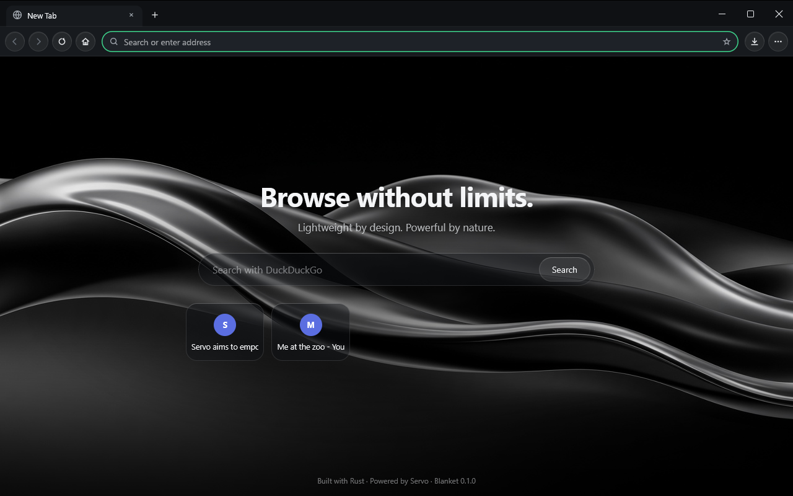
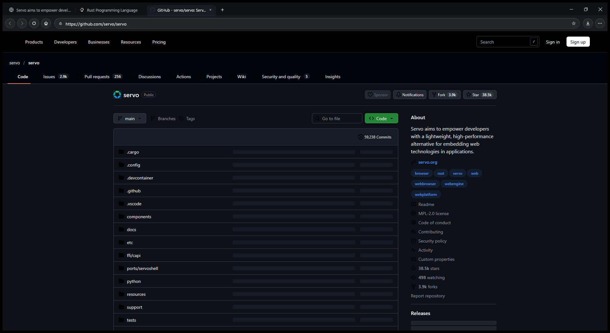

<div align="center">


# blanket

### Navegue sem limites.

**Leve por design. Poderoso por natureza.**

Um navegador para Windows escrito em Rust, com um motor moderno, uma interface limpa e
tudo o que você precisa — sem o peso de sempre.

[Baixar e compilar](#comece-agora) · [Recursos](#por-que-blanket) · [Roadmap](#o-que-vem-por-aí)

</div>

<br>



<br>

## Por que Blanket?

A maioria dos navegadores é um mesmo motor com outra pintura por cima. O Blanket começa
diferente: é construído em **Rust**, sobre o **Servo** — o motor web moderno, paralelo e
seguro em memória que deu origem a partes do Firefox. O resultado é um navegador que
abre rápido, responde rápido e trata a sua memória como um recurso precioso.

<table>
<tr>
<td width="50%" valign="top">

### ⚡ Rápido de verdade
Abre em cerca de meio segundo. Estilo e layout das páginas são calculados em paralelo, usando
todos os núcleos do seu processador.

</td>
<td width="50%" valign="top">

### 🪶 Leve com a sua RAM
Abas que você não usa há algum tempo **adormecem sozinhas** e liberam memória — e
acordam exatamente onde você parou, com rolagem e histórico.

</td>
</tr>
<tr>
<td valign="top">

### 🎬 Tudo funciona
YouTube, Twitch, Netflix e outros sites de vídeo abrem automaticamente no **modo de
compatibilidade**. Você não precisa pensar nisso — só assistir.

</td>
<td valign="top">

### 🔒 Seguro por construção
Rust elimina classes inteiras de falhas de memória. HTTPS por padrão, nenhuma página —
nem as internas — tem acesso ao seu histórico ou às suas configurações.

</td>
</tr>
</table>

<br>



<br>

## Pensado nos detalhes

- **Abas na barra de título**, como você já conhece — com mais espaço para o que importa.
  Clique em qualquer ponto acima de uma aba para selecioná-la, sem precisar mirar.
- **Barra de endereço que adivinha.** Digite `you` e o Blanket completa `youtube.com`.
  Ele aprende com os sites que você mais visita e com os mais recentes.
- **Nova aba linda e útil**: seus sites favoritos a um clique, sobre uma arte de seda líquida.
- **Animações suaves** em abas, menus, painéis e botões — tudo desliza, nada pisca.
- **Abrir em segundo plano**: “Abrir link em nova aba” não te tira da página que você está lendo.
- **Painéis nativos** para histórico, favoritos, downloads, desempenho e configurações.
- **Barra de favoritos discreta**: só aparece quando você tem favoritos.
- **Tema escuro elegante**, com controles em vidro translúcido e um único verde de destaque.

## Modo de compatibilidade

A web é enorme, e alguns sites usam tecnologias de vídeo que o Servo ainda está
implementando. Em vez de te deixar na mão, o Blanket abre esses sites automaticamente com
o mecanismo **WebView2** do Windows — o mesmo do Microsoft Edge — dentro da mesma janela,
na mesma barra de abas, com o mesmo histórico e a mesma barra de endereço.

- Ligado por padrão para YouTube, Twitch, Netflix, Prime Video, Disney+, Max, Globoplay,
  Crunchyroll, Vimeo, Spotify, TikTok e Kick.
- Você decide: ligue, desligue ou edite a lista em **Configurações → Modo de compatibilidade**.
- Saiu do site de vídeo? A navegação volta para o Servo na mesma aba.

## O que vem por aí

- Áudio e vídeo nativos no Servo via GStreamer para todos os outros sites
- Sincronização de favoritos e sessões
- Importação de dados do Chrome, Edge e Firefox
- Instalador com atualização automática
- macOS e Linux

## Comece agora

O Blanket está em desenvolvimento ativo e, por enquanto, é distribuído como código-fonte
para **Windows 10/11 (x64)**.

```powershell
git clone https://github.com/CaduhRoman/blanket
cd blanket
. .\scripts\dev-env.ps1
cargo run -p blanket --release
```

A primeira compilação leva alguns minutos (o motor inteiro é compilado na sua máquina).
Requisitos e detalhes em [docs/BUILDING.md](docs/BUILDING.md).

<details>
<summary><b>Para desenvolvedores</b></summary>

<br>

| Componente | Papel |
| --- | --- |
| `blanket` | Janela, interface (egui) e integração com os motores |
| `blanket-core` | Abas, memória, histórico, autocomplete, sessão, segurança — sem dependência de motor |
| `blanket-net` | Downloads |
| `blanket-bench` | Medições reproduzíveis de desempenho |

- Limitações conhecidas do motor: [docs/LIMITATIONS.md](docs/LIMITATIONS.md)
- Benchmarks: [docs/BENCHMARKS.md](docs/BENCHMARKS.md)
- Correções aplicadas ao Servo: [third_party/README.md](third_party/README.md)

</details>

<br>

<div align="center">

**Feito com Rust. Movido a Servo.**

<sub>Licença MPL-2.0 · © CaduhRoman</sub>

</div>
